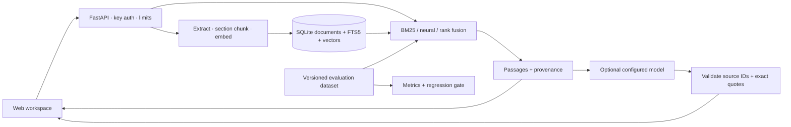

# DocAtlas

**Documentation answers with evidence you can inspect.**

Search your documents, inspect the supporting passages, and optionally generate
cited draft answers. DocAtlas runs locally and works without a model API key.

- Import Markdown, text, HTML, DOCX and text-based PDFs.
- Search with BM25 by default; optionally use local neural or hybrid retrieval.
- Inspect sources, track upload jobs and export evidence in the browser workspace.
- Evaluate retrieval changes against a versioned development dataset.

[Quick start](docs/QUICKSTART.md) · [Contribute](CONTRIBUTING.md) ·
[Good first issues](https://github.com/nymav/docatlas/issues?q=is%3Aissue+is%3Aopen+label%3A%22good+first+issue%22)


## Run locally

Requires Python 3.11+ (3.12 is tested), SQLite with FTS5, and a modern browser.

```bash
git clone https://github.com/nymav/docatlas.git
cd docatlas
python3 -m venv .venv
source .venv/bin/activate
python -m pip install -c requirements.lock .
docatlas serve
```

Open **http://127.0.0.1:8000**. Upload your documents in the library. Jobs persist
across refreshes and restarts; failed replacements preserve the previous index.
DOCX tables are flattened by row, and PDF extraction warnings identify sparse pages;
scanned PDFs still need OCR before upload. See [production progress](docs/PRODUCTION_PROGRESS.md). The app works
without an API key in explicitly labeled evidence mode: it returns real retrieved
passages, not fabricated model responses.

For neural and hybrid retrieval, set `DOCATLAS_EMBEDDINGS=fastembed` before ingestion
and startup. The first ingestion downloads a small English ONNX embedding model;
later inference is local. Switching embedding models requires re-ingesting the corpus.

```bash
export DOCATLAS_EMBEDDINGS=fastembed
python scripts/fetch_corpus.py
docatlas ingest data/corpus --manifest data/corpus-sources.json
docatlas serve
```

The fetcher downloads only the public, revision-pinned FastAPI corpus and verifies
checksums. Its documentation may contain unexpanded upstream code-include directives;
the development questions target text passages rather than omitted source snippets.

## Technology stack

Python 3.11+ · FastAPI / Uvicorn · SQLite FTS5 · NumPy · vanilla JavaScript.
Optional FastEmbed provides local ONNX embeddings. Optional generation uses a
configured OpenAI-compatible provider. See [architecture](#architecture-and-decisions).

For a first question with a bundled fictional document, follow the
[guided walkthrough](docs/QUICKSTART.md). For development dependencies and checks,
see [contributing](CONTRIBUTING.md).

## Connect a model

Open **Model setup** in the browser. For local generation:

1. Open LM Studio, load a chat model, and start its local server on port 1234.
2. Keep **Serve on Local Network** and CORS disabled for a local installation.
3. Choose LM Studio, use `http://127.0.0.1:1234/v1`, and click **Discover models**.
4. Select a chat model. Set context size to its **loaded** context, not its advertised
   maximum. Adjust output tokens and timeout for your hardware.
5. Save settings, then click **Test generation**. A passing test checks connection,
   structured output, source IDs and quotations. It does not certify answer accuracy.

An optional remote API provider requires a trusted HTTPS `/v1` endpoint supporting
OpenAI-compatible chat completions and JSON schema or JSON object output. The screen
explicitly labels remote transmission: questions and selected passages go to that
provider. DocAtlas never silently switches providers. Provider keys are stored only
server-side in `data/provider.json` with owner-only file permissions; this is a local
plaintext secret, so protect that directory and backups. Model setup is restricted
to direct localhost connections. The workspace access key is separate.

Saved settings take precedence over environment settings. Before saving settings,
`DOCATLAS_LLM_URL`, `DOCATLAS_LLM_MODEL`, and related variables may configure a provider.
Set `DOCATLAS_LLM_KIND=api` for remote endpoints. To return to environment settings,
stop the app and move `data/provider.json` to a private backup location.

A live integration smoke run with the installed Mistral 7B model passed connection
and structured-output checks, but exposed truncation and a semantically unsupported
claim whose quotation was real. Those are quality failures, not proof of production
readiness. See [live validation](docs/LIVE_PROVIDER_VALIDATION.md) and the
[production work plan](docs/PRODUCTION_PLAN.md). Re-run locally with:

```bash
python scripts/validate_local_provider.py --model YOUR_MODEL --context LOADED_CONTEXT
```

This uses public repository documentation in a temporary library. It does not alter
user documents. Reports are written under ignored `data/`; `--configure` explicitly
saves the tested provider. Its exit code checks integration only; manually review
all claims and quotes for meaning before counting a quality pass.

`.env.example` documents supported environment variables. The Python CLI reads the
process environment; it does **not** automatically load `.env`. Docker Compose does.

## Measured, not assumed

A local development evaluation over **12 public FastAPI pages, 223 passages and 30
AI-authored questions** produced the following results at k=5:

| Method | Evidence recall@5 | MRR@5 | Out-of-corpus abstention |
|---|---:|---:|---:|
| BM25 | 0.9583 | 0.8090 | 1.0000 |
| Neural | 0.8750 | 0.7896 | 0.6667 |
| Hybrid | 0.9583 | 0.7986 | 0.6667 |

**Interpretation:** hybrid did not outperform BM25 on this small, terminology-heavy
development set. Neural retrieval reduced false abstentions on answerable questions,
but accepted two personal-data questions that the public corpus could not answer.
The default installation therefore starts with BM25; enable neural/hybrid explicitly
and evaluate it on your own corpus. See [full results](evals/development-results.md)
and [evaluation limitations](evals/README.md). These figures are not generated-answer
accuracy, a human-reviewed benchmark, or a production SLA.

## Evaluate and prevent regressions

```bash
docatlas eval evals/fastapi-development.jsonl --modes bm25 dense hybrid --output data/report.json
docatlas eval evals/fastapi-development.jsonl --modes bm25 dense hybrid \
  --output data/candidate.json --baseline data/report.json --tolerance 0.01
pytest -q
ruff check src tests scripts
```

The evaluator writes JSON plus a readable Markdown report, per-category metrics and
failed cases. It fails on missing labels, incompatible datasets or regressed quality.
Tests prove a deliberately degraded report fails the gate. GitHub Actions runs unit
and API checks plus a container smoke test on pushes/PRs. A manually triggered public
corpus workflow runs the real embedding benchmark without paid model calls.

## Container deployment

```bash
cp .env.example .env
# Set DOCATLAS_API_KEY to a strong workspace secret in .env.
# Set DOCATLAS_EMBEDDINGS=fastembed if you want neural retrieval.
docker compose up --build -d
```

Compose publishes only on localhost and persists data/model weights in a named volume.
Enter the workspace key in the web app when prompted. The key is kept in tab memory,
not local storage. For a network deployment, use a TLS reverse proxy and set the key.
All holders of that key share one library and may add/delete documents. This is a
single-workspace service, not a multi-tenant SaaS identity system.

## Architecture and decisions



- **SQLite + exact vector search:** simple, persistent and inspectable for small
  libraries; every query currently scans candidate vectors. It is not designed for
  million-passage corpora. Move to an ANN index when measured scale requires it.
- **Atomic ingestion:** embedding succeeds before replacing the old document and
  both indexes in one transaction. Duplicate uploads are idempotent. Filename is
  document identity; two different documents need distinct filenames.
- **Constrained answers:** source membership and exact quotes are validated. This
  does not prove semantic entailment; a real quote can still support a misleading
  interpretation. No claim is made that prompt injection or hallucination is solved.
- **No silent simulation:** missing providers yield evidence-only results, failed
  generation yields a visible fallback, and unavailable neural retrieval returns an
  actionable error. No tool execution or external URL crawling is exposed.

See [operations](docs/OPERATIONS.md), [security](SECURITY.md), and the
[release acceptance criteria](docs/RELEASE_SCOPE.md).


## Help improve DocAtlas

Try the quick start and tell us which step was unclear. Use the onboarding feedback
issue form; a fresh perspective is useful. Small documentation improvements and
focused regression tests are welcome. Read [contributing](CONTRIBUTING.md) and the
[code of conduct](CODE_OF_CONDUCT.md) before opening a PR.

## License

DocAtlas is distributed under the [MIT license](LICENSE). Dependencies and the
public evaluation corpus retain their own licenses; see [corpus details](evals/README.md).
